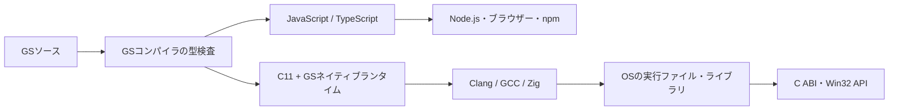

<div align="center">

# GScript

**JavaScriptのエコシステムへ。OSのネイティブAPIへ。**

Go風の構文と独自の型検査を備えた、2つの実行経路を持つ言語。

[言語ガイド](docs/language-v0.5.md) · [JS / TS](docs/cli.md) · [ネイティブ](#ネイティブで使う) · [ライブラリ互換性](#ライブラリ互換性) · [エディター](docs/editors.md)

[](https://github.com/sofia-gros/gscript/actions/workflows/test.yml)

</div>

```go
func square(value int) int {
  return value * value
}
println(square(12))
```

GScript（GS）は、JavaScript / TypeScriptへの変換と、独自ランタイムによるネイティブ動作を軸に開発している言語です。JS / TS経路は公開済みで、機械語へのAOTコンパイル経路は現在開発中です。構文・型・スコープはGSコンパイラが検査します。



## 2つの実行経路

| | JS / TS | Native |
| --- | --- | --- |
| 生成物 | `.js` / `.mjs` / `.ts` | 実行ファイル・オブジェクト・静的／共有ライブラリ |
| 実行環境 | Node.js・ブラウザー等 | 対象OSとリンクしたライブラリ |
| ライブラリ | JavaScript・TypeScript・npm・JSDoc・`.d.ts` | C ABI、固定幅型、ポインター、コールバック、OS API |
| GSの検査 | GSコンパイラ | GSコンパイラのネイティブ型検査 |
| 配布状況 | [v0.5.0で公開済み](https://github.com/sofia-gros/gscript/releases/tag/v0.5.0) | 開発中。実装・検証後に公開予定。v0.5.0には未収録 |

開発中のネイティブ出力には、文字列・出力・数値エラー処理等を担う小さなGSランタイムが静的に組み込まれます。実行にNode.js・Python・JSエンジンは必要としない構成です。ウィンドウ・イベントループ・描画機能は、C ABIを使うライブラリとして実装する設計です。

## JS / TSで使う

[OS別インストール手順](docs/installation.md)に従い、公開済みコンパイラを導入します。冒頭のコードを`main.gs`として保存してください。

```sh
gs main.gs
node dist/main.js
```

```sh
gs .                            # プロジェクトをminify JSへ
gs . --no-minify                 # 可読JSへ
gs . --format mjs
gs . --format ts
gs . --sourcemap --declaration
gs . --ts-compiler ts            # GS検査後に公式TSでJS生成
```

設定ファイルは必須ではありません。GSモジュールの依存を解決し、必要なES Modules設定を生成します。外部JS/TS・npmの型情報はTypeScript APIから読み取り、GS自身が呼び出しの適否を検査します。

```sh
npm install --save-dev typescript@5.9.3
npm install phaser@3.90.0
gs game.gs --check
```

Node.js・TypeScript・npmとの既存互換性はJS / TS経路で維持します。[外部型・TS 5.9/6.0/7.0・Node/DOM/Worker設定](docs/typescript-interop.md)

## ネイティブで使う

ネイティブ経路は現在開発中です。既存のv0.5.0 Releaseおよび現在公開済みのCLIには含まれていません。実装と検証の公開後に、導入コマンドとネイティブ用ガイドを追加します。

設計は`GS → GSによる型検査 → C11 + 小さなGSランタイム → Clang / GCC / Zig → 機械語`です。固定幅整数、ポインター、C互換struct/union、固定長配列、関数ポインター、Windowsの`system`呼び出し規約を対象とします。実行ファイルに加え、オブジェクト・静的／共有ライブラリの生成を整備しています。

ウィンドウ構築・イベントループ・レンダリングは、C ABIやWin32 APIを利用するGSライブラリとして実装できるようにします。ウィンドウ・描画ライブラリ自体は今回の開発対象に含めていません。

## ライブラリ互換性

| ライブラリ | 対応する実行経路 |
| --- | --- |
| Node.js標準API・npmのJS / TSパッケージ | 公開済みのJS / TS経路で利用 |
| Phaser等のブラウザーライブラリ | JS / TS経路で型検査・生成し、対応実行環境で利用 |
| C ABIを持つ既存ライブラリ | 開発中のNative経路で連携を整備 |
| Win32 API・OS API | Native経路の外部関数・コールバックから接続する設計 |
| GSで作るネイティブライブラリ | C ABIで公開し、C等からも呼び出せる構成を開発中 |

Node.js・TypeScript・npmとの既存互換性を維持します。JSライブラリはJSの実行環境、C ABIライブラリは対応するネイティブ環境で利用します。両経路の型・メモリ表現・対応範囲は、それぞれの仕様として明示します。

## 言語と開発ツール

JS / TS経路では、struct継承、interface、generics、union、nullable、enum、async/await、optional chaining等を利用できます。intとfloatはコンパイル時に区別し、生成JSへ数値型のタグや判定処理を追加しません。

```sh
gs init demo --template node     # browser / phaserも選択可能
gs . --check
gs lint
gs fmt
gs watch
```

[VSCode・Zed・LSP v0.5.0](https://github.com/sofia-gros/gscript/releases/tag/plugin-v0.5.0)では、ハイライト、診断、定義・参照、リネーム、補完、Signature Help、整形を提供します。現行のエディター統合とlint/fmt/watchはJS / TS用です。ネイティブ用の検査・エディター連携は開発状況に合わせて別途案内します。

## ドキュメント

| 目的 | ガイド |
| --- | --- |
| 全体構成を理解する | [2つの実行経路](#2つの実行経路) |
| JSコンパイラを導入する | [インストール](docs/installation.md)・[CLI](docs/cli.md) |
| ネイティブ実行・FFI・ライブラリ | 開発中。実装と同時に詳細ガイドを追加予定 |
| Node/npmとC ABIの対応範囲を確認する | [ライブラリ互換性](#ライブラリ互換性) |
| 型・生成物を理解する | [言語](docs/language-v0.5.md)・[数値](docs/numeric-types.md)・[Source Map](docs/source-maps.md)・[型宣言](docs/declarations.md) |
| 更新・検証 | [v0.4→v0.5](docs/migration-v0.4-to-v0.5.md)・[性能](docs/performance.md)・[エディター](docs/editors.md) |

## 開発と検証

```sh
npm ci --ignore-scripts
python -m unittest discover -s tests -v
```

公開済みのJS / MJS / TSの実行・外部型・Phaser・配布物を検証します。開発中のネイティブ経路では、C ABIの双方向呼び出し、structレイアウト、コールバック、ライブラリ出力、Win32 SDKとのABI一致を追加検証しています。
