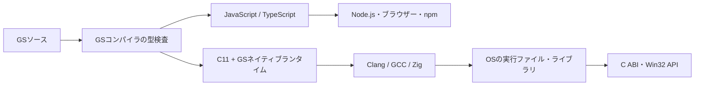

<div align="center">

# GScript

**JavaScriptのエコシステムへ。OSのネイティブAPIへ。**

Go風の構文と独自の型検査を備えた、2つの実行経路を持つ言語。

[言語ガイド](docs/language-v0.5.md) · [JS / TS](docs/cli.md) · [ネイティブ](docs/native.md) · [ライブラリ互換性](docs/library-compatibility.md) · [エディター](docs/editors.md)

[](https://github.com/sofia-gros/gscript/actions/workflows/test.yml)

</div>

```go
func square(value int) int {
  return value * value
}
println(square(12))
```

GScript（GS）は、JavaScript / TypeScriptへの変換と、独自のネイティブランタイムを伴う機械語へのAOTコンパイルを提供します。構文・型・スコープはGSコンパイラが検査します。



## 2つの実行経路

| | JS / TS | Native |
| --- | --- | --- |
| 生成物 | `.js` / `.mjs` / `.ts` | 実行ファイル・オブジェクト・静的／共有ライブラリ |
| 実行環境 | Node.js・ブラウザー等 | 対象OSとリンクしたライブラリ |
| ライブラリ | JavaScript・TypeScript・npm・JSDoc・`.d.ts` | C ABI、固定幅型、ポインター、コールバック、OS API |
| GSの検査 | GSコンパイラ | GSコンパイラのネイティブ型検査 |
| 配布状況 | [v0.6.0で配布](https://github.com/sofia-gros/gscript/releases/tag/v0.6.0) | v0.6.0の実験的バックエンド |

ネイティブ出力には、文字列・出力・数値エラー処理等を担う小さなGSランタイムが静的に組み込まれます。実行にNode.js・Python・JSエンジンは必要ありません。ウィンドウ・イベントループ・描画機能は、C ABIを使うライブラリとして実装する設計です。

## JS / TSで使う

[OS別インストール手順](docs/installation.md)に従い、公開済みコンパイラを導入します。冒頭のコードを`main.gs`として保存してください。

```sh
gs main.gs
node dist/main.js
```

```sh
gs .                            # プロジェクトをminify JSへ
gs . --no-minify                 # 可読JSへ
gs . --format mjs
gs . --format ts
gs . --sourcemap --declaration
gs . --ts-compiler ts            # GS検査後に公式TSでJS生成
```

設定ファイルは必須ではありません。GSモジュールの依存を解決し、必要なES Modules設定を生成します。外部JS/TS・npmの型情報はTypeScript APIから読み取り、GS自身が呼び出しの適否を検査します。

```sh
npm install --save-dev typescript@5.9.3
npm install phaser@3.90.0
gs game.gs --check
```

Node.js・TypeScript・npmとの既存互換性はJS / TS経路で維持します。[外部型・TS 5.9/6.0/7.0・Node/DOM/Worker設定](docs/typescript-interop.md)

## ネイティブで使う

ネイティブ機能はv0.6.0のコンパイラから利用できます。コード生成にはGCC互換のC11ドライバー（Clang・GCC・Zig）が必要です。ソース版から使う場合はPython 3.12以降も必要です。

```sh
git clone https://github.com/sofia-gros/gscript.git
cd gscript
python -m gscript examples/native/hello.gs --backend native
./examples/native/dist/native/hello
```

Cコンパイラを明示する場合は`--cc /absolute/path/to/clang`、Zigなら`--cc /absolute/path/to/zig`を指定します。Windowsでは生成された`.exe`を実行します。環境別の導入とコマンドは[ネイティブガイド](docs/native.md)に記載しています。

```sh
# 公開関数を持つ共有ライブラリとCヘッダー
python -m gscript examples/native/library.gs --backend native \
  --emit shared -o dist/libgs_math.so --header dist/gs_math.h

# Windows x64向けの実行ファイル（Zigと対象のリンクライブラリを使用）
python -m gscript examples/native/win32-probe.gs --backend native \
  --cc /absolute/path/to/zig --target x86_64-windows-gnu -o dist/probe.exe
```

ネイティブ経路は静的なGSとC ABI連携を優先する実験段階です。固定幅整数、ポインター、C互換struct/union、固定長配列、関数ポインター、Windowsの`system`呼び出し規約を扱います。数値・文字列・structの意味と、対応構文の範囲は[ネイティブ仕様](docs/native.md#型とメモリの規則)を参照してください。

## 言語と開発ツール

JS / TS経路では、struct継承、interface、generics、union、nullable、enum、async/await、optional chaining等を利用できます。intとfloatはコンパイル時に区別し、生成JSへ数値型のタグや判定処理を追加しません。

```sh
gs init demo --template node     # browser / phaserも選択可能
gs . --check
gs lint
gs fmt
gs watch
```

[VSCode・Zed・LSP v0.6.0](https://github.com/sofia-gros/gscript/releases/tag/plugin-v0.6.0)では、ハイライト、診断、定義・参照、リネーム、補完、Signature Help、整形を提供します。エディターは`gsconfig.json`の`backend`を共用し、ネイティブ構文の診断・基本的な編集機能にも対応します。lint/fmt/watchのCLIはJS / TS用です。[Nativeのエディター設定](docs/native.md#エディター設定)を参照してください。

## ドキュメント

| 目的 | ガイド |
| --- | --- |
| 全体構成を理解する | [実行モデル](docs/execution-models.md) |
| JSコンパイラを導入する | [インストール](docs/installation.md)・[CLI](docs/cli.md) |
| ネイティブ実行・FFI・ライブラリを作る | [Native](docs/native.md) |
| Node/npmとC ABIの対応範囲を確認する | [ライブラリ互換性](docs/library-compatibility.md) |
| 型・生成物を理解する | [言語](docs/language-v0.5.md)・[数値](docs/numeric-types.md)・[Source Map](docs/source-maps.md)・[型宣言](docs/declarations.md) |
| 更新・検証 | [v0.4→v0.5](docs/migration-v0.4-to-v0.5.md)・[性能](docs/performance.md)・[エディター](docs/editors.md) |

## 開発と検証

```sh
npm ci --ignore-scripts
python -m unittest discover -s tests -v
```

JS / MJS / TSの実行・外部型・Phaser・配布物に加え、ネイティブ実行、C ABIの双方向呼び出し、structレイアウト、コールバック、ライブラリ出力を検証します。Win32の検証はウィンドウを作らず、SDKのABIとOS APIを確認します。
